# 面向开放世界的具身感知与行动智能

[多模态感知](multimodal-perception/README.md) · [具身导航模型](vln/README.md) · [具身操作模型](vla/README.md) · [开放数据集](datasets/README.md)

## 研究概览

面向开放世界的具身感知与行动智能，聚焦机器人对环境的理解、自主移动与物体操作，围绕多模态感知、具身导航模型、具身操作模型三个方向开展研究，覆盖数据集构建、模型方法、仿真评估与实机验证。

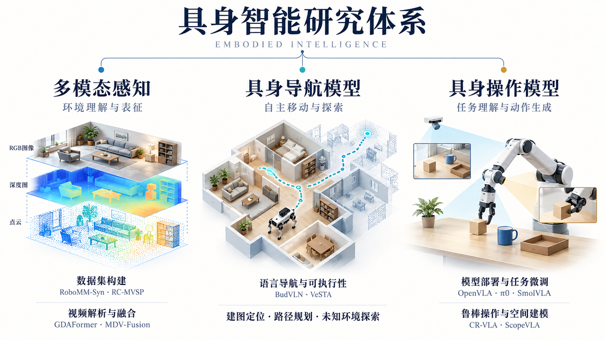

## 研究成果

| 方向 | 成果 | 图表详情 |
| --- | --- | --- |
| 多模态感知 | RoboMM-Syn、RC-MVSP、GDAFormer、MDV-Fusion | [数据集与算法](multimodal-perception/README.md) |
| 具身导航模型 | BudVLN、VeSTA、建图导航与未知环境探索 | [框架与实验](vln/README.md) |
| 具身操作模型 | 开源模型部署与微调、CR-VLA、ScopeVLA | [框架与实验](vla/README.md) |

### 多模态感知

| 数据资源 | 规模 | 开源入口 |
| --- | --- | --- |
| RoboMM-Syn 仿真数据集 | 约 15,000 个实例级对象 | [ModelScope](https://www.modelscope.cn/datasets/XDUEaiLAB/RoboMM-Syn) |
| 真实机器人多模态感知数据集 | 1,000 段视频、100,532 帧、200 类 | [ModelScope](https://www.modelscope.cn/datasets/XDUEaiLAB/Robot_multimodal_perception_dataset) |

<table>
<tr><th width="50%">室内视频场景解析</th><th width="50%">室外视频场景解析</th></tr>
<tr>
<td>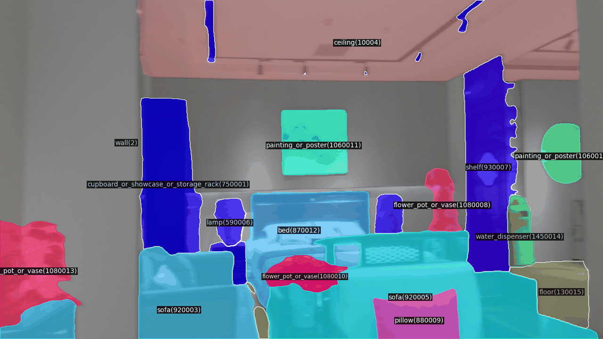</td>
<td>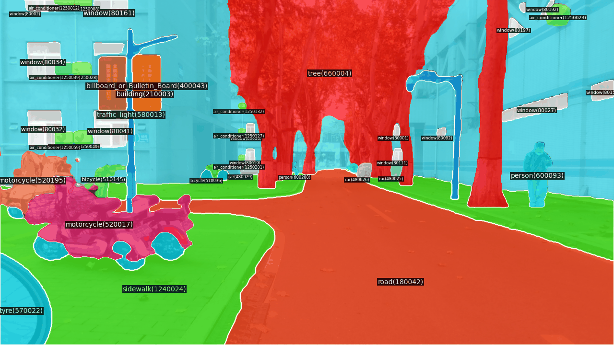</td>
</tr>
</table>

[数据样例、GDAFormer 与 MDV-Fusion 框架和结果 →](multimodal-perception/README.md)

#### 仿真多模态数据采集

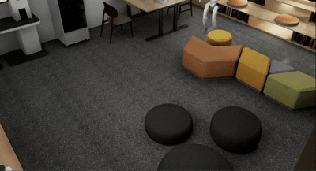

### 具身导航模型

| 方法 | 测试设置 | 代表结果 |
| --- | --- | --- |
| BudVLN | R2R-CE / RxR-CE，Val Unseen | SR：57.6% / 56.1%；SPL：51.1% / 46.6% |
| VeSTA | Go2 无碰撞成功率，每场景 20 条指令 | 走廊 95%；卧室 65%；跨房间 45% |

<table>
<tr><th width="50%">出门右转，在红色灭火器前停下</th><th width="50%">直行走出房间，进入左边的房间，在冰箱前停下</th></tr>
<tr>
<td align="center">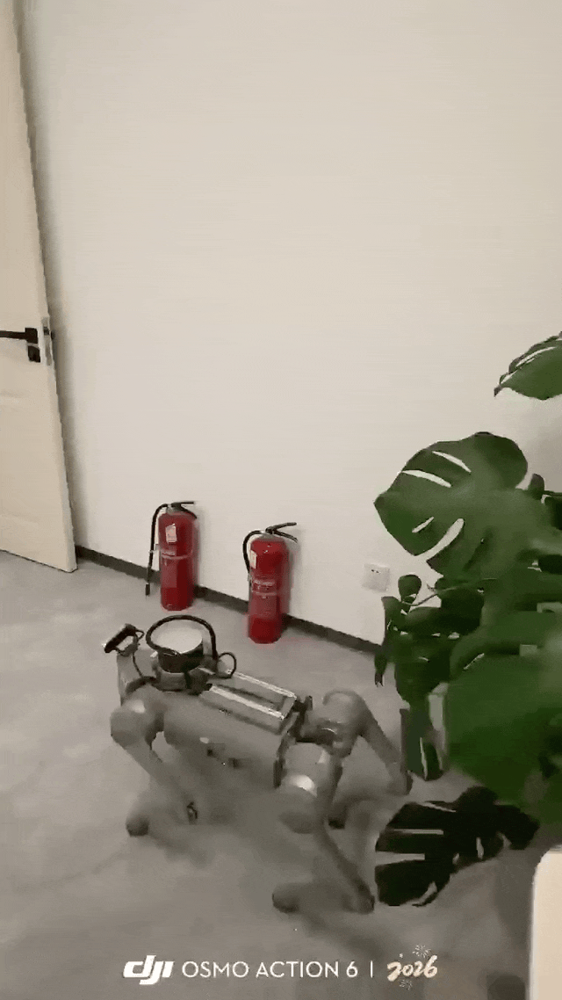</td>
<td align="center">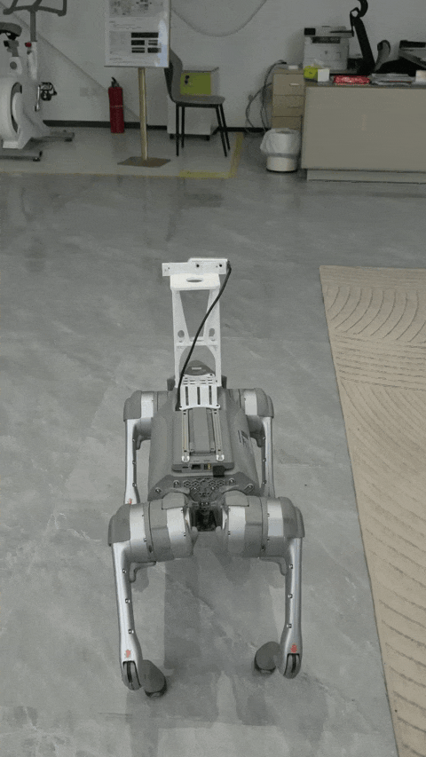</td>
</tr>
</table>

#### 建图导航与未知环境探索

| 建图与路径规划 | 未知环境仿真探索 |
| --- | --- |
| 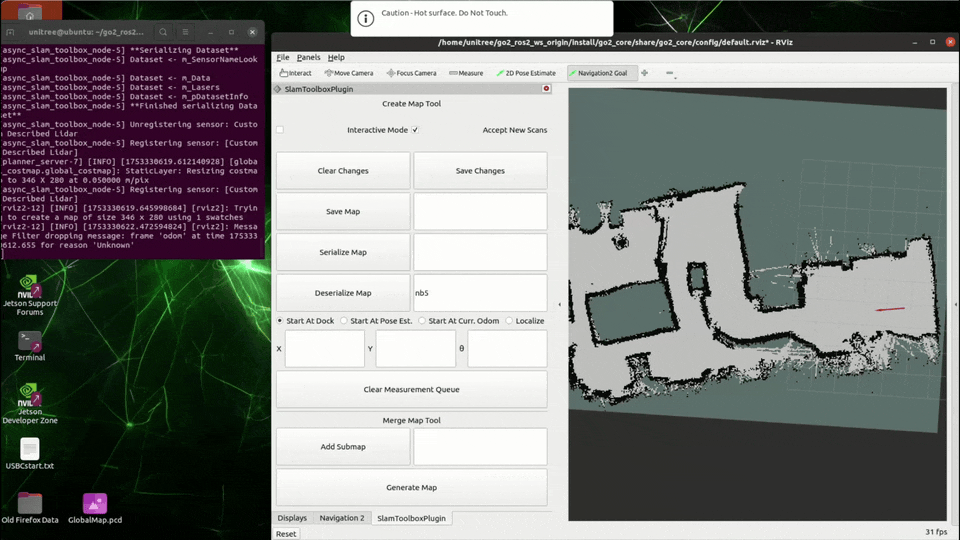 | 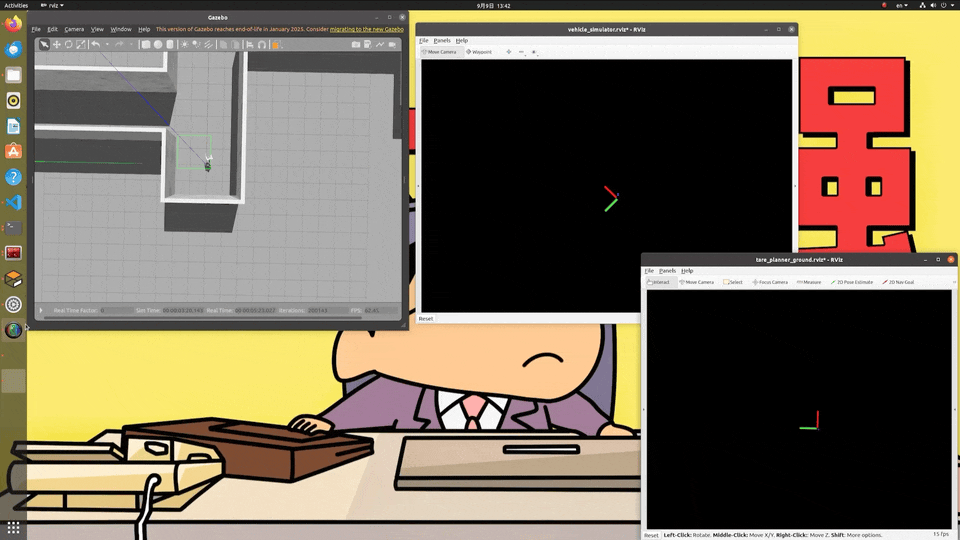 |

[BudVLN、VeSTA、建图导航与探索的框架和结果 →](vln/README.md)

### 具身操作模型

| 能力 / 方法 | 设置 | 展示与结果 |
| --- | --- | --- |
| 开源 VLA 部署与微调 | OpenVLA、π0、SmolVLA 等 | 抽屉、物体抓放、组合餐具操作 |
| CR-VLA | CALVIN 波动带宽 | 五步成功率 56.9%；平均完成长度 3.758 |
| CR-VLA | AgileX 实机波动带宽，每任务 20 次 | 香蕉 80%；叠盘 65%；餐具 60%；抽屉 60% |
| ScopeVLA | CALVIN ABC→D / LIBERO-Plus 零样本迁移 | 五步成功率 85.3%；平均完成长度 4.62 / 总成功率 67.4% |
| ScopeVLA | AgileX 实机，每任务 20 次 | 四任务平均成功率 80% |

<table>
<tr><th>抽屉与茄子操作</th><th>组合餐具操作</th><th>香蕉放入盘子</th></tr>
<tr>
<td width="33%">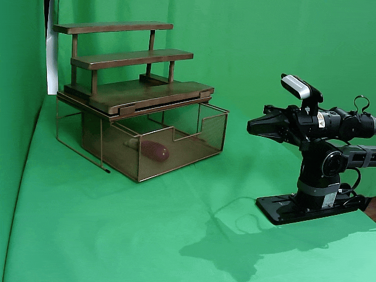</td>
<td width="33%">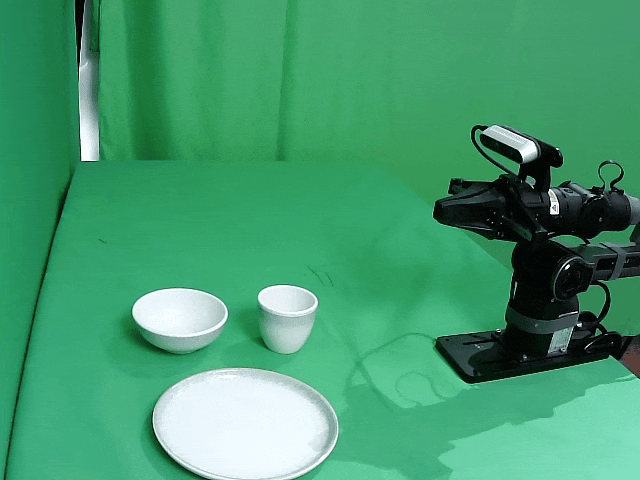</td>
<td width="33%">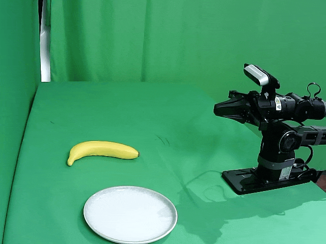</td>
</tr>
</table>

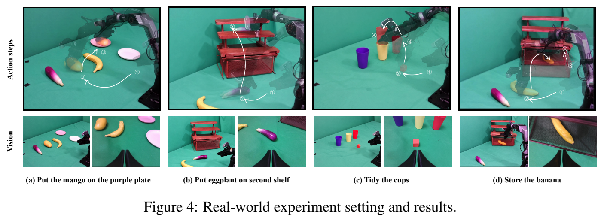

[CR-VLA 与 ScopeVLA 的框架、实验表格和实机结果 →](vla/README.md)
